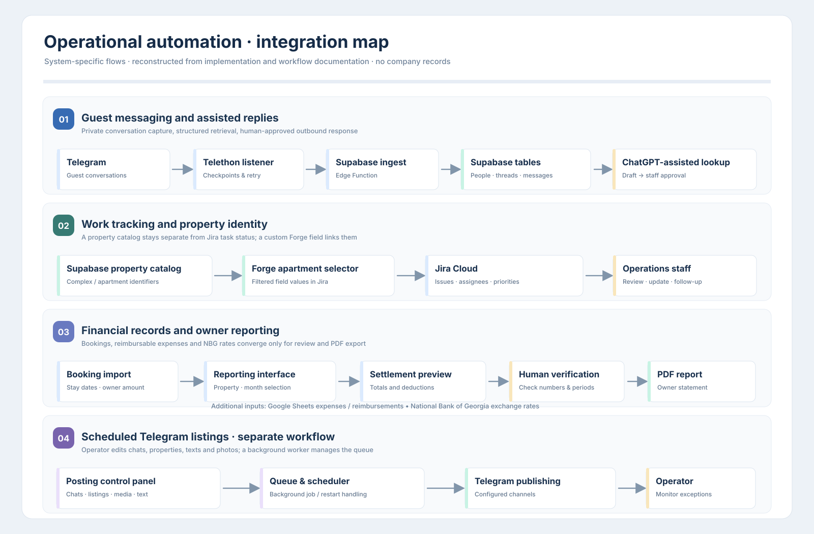
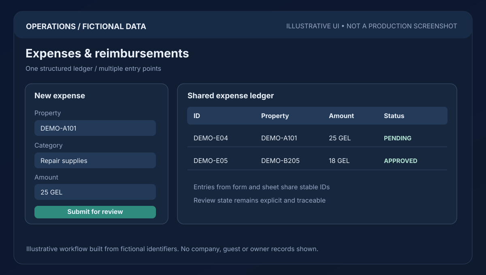
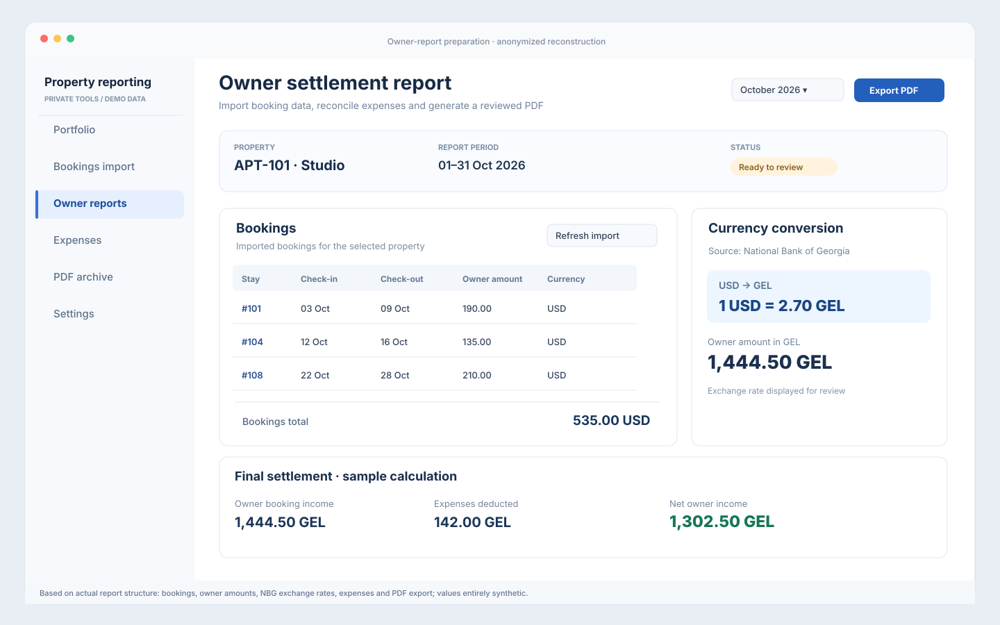
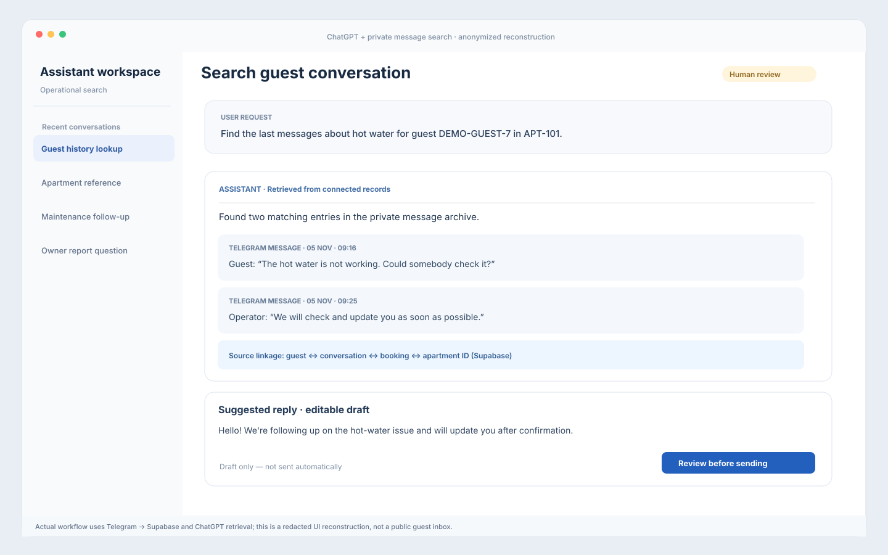

# Property-management operations automation

**Role:** operations workflow design, AI-assisted integration, delivery and maintenance  
**Stack:** Jira · Supabase · Google Sheets · Apps Script · lightweight web forms · LLM workflows  
**Scope:** real operational work; diagrams and all records below are anonymized or fictional.



## The problem

Managing an apartment portfolio means processing bookings, guest requests, check-ins/check-outs, cleaning, repairs, utilities, staff assignments, owner communication and expenses. When the relevant facts are spread across several channels, small teams lose time cross-checking spreadsheets and chats, and urgent work can become ownerless.

## What I built and operated

**A structured apartment information layer.** Organized property identifiers and operational details in a Supabase-backed database, so an assistant and internal tools could refer to one property record rather than relying on ambiguous room names in messages.

**Task and issue coordination.** Designed Jira workflows for assignments, priorities, maintenance issues and follow-ups, using AI-generated scripts and integrations for routine administration. Human decisions — such as approvals and guest promises — remained assigned to responsible staff.

**Expense input and review.** Designed lightweight HTML/Apps Script interfaces around Google Sheets for expenses and reimbursements. The difficult part was not just the form: the interface had to reflect changes entered elsewhere in the same table, including entries recorded by a teammate.

**LLM-assisted operational retrieval.** Used structured queries and an AI assistant to speed up looking up apartment information and turning natural-language requests into reviewable operational actions. LLM output is not automatically authoritative; the source records and user confirmation matter.

**Owner and staff communication.** Prepared data views and reporting workflows that combine records from different parts of the operation.

### My contribution

I mapped requirements, chose record structures and responsibilities, specified changes to AI coding assistants, configured integrations, debugged failures, validated results and trained the workflow around how colleagues actually worked. This is **AI-assisted implementation**, not a claim of expert hand-written Python or a standalone production SaaS.

## Example 1 · From guest problem to a resolved issue

All entities in this example are fictional.

| Stage | Example record | Review rule |
| --- | --- | --- |
| Incoming request | `EX-102`: no hot water | Resolve apartment ID and booking context |
| Structured issue | `ISSUE-0007`, category `maintenance` | Explicit owner, priority, current status |
| Assignment | Technician A, due 2026-11-08 | No unconditional promise to guest before confirmation |
| Follow-up | `assigned → in_progress → resolved` | Status must reflect actual work, not an LLM guess |
| Report | Resolution time and expense reference | Preserve audit trail and avoid exposing guest contacts |

## Example 2 · Expense reconciliation

A fictional employee enters a 25 GEL repair expense using an internal form. Another teammate records a different expense directly in Google Sheets. Both records must appear in the review interface, and the same expense must not be entered twice.

```json
{
  "expense_id": "DEMO-EXP-0004",
  "property_id": "EX-102",
  "date": "2026-11-06",
  "category": "repair",
  "amount": 25,
  "currency": "GEL",
  "reimbursement_status": "pending"
}
```

**Acceptance criteria used when reviewing this kind of workflow:** a stable row ID, read-after-write confirmation, timestamp and currency validation, duplicate handling, and a clear error state when the source table cannot be reached. A good-looking interface alone is not proof that its data is synchronized.

## Three representative workflows — fictional UI illustrations

The following **schematic mock screens were created specifically for this portfolio** using invented data. They explain actual kinds of operational workflows; they are **not captures or exports of company software**, and their displayed totals are not measured business outcomes.

### 1. Expenses and reimbursements: form ↔ shared ledger



**Problem:** teammates enter expenses through different routes, including a lightweight form and direct spreadsheet entry. A dashboard built from stale local state risks silently omitting valid rows.

**Input → interaction → output:** a fictional `DEMO-A101` repair expense for 25 GEL is submitted; the shared ledger returns a stable ID and visible approval status. Changes made directly in the source sheet must appear after refresh.

**Verification contract:** same row IDs in the sheet and UI, no duplicates from retried submissions, currency and amount validation, explicit read/write failures, and approval kept with the responsible person. This is a design and review pattern, **not a claim that perfect synchronization was independently audited**.

### 2. Owner reports: consolidate → reconcile → review



**Problem:** a report must reconcile booking amounts, expense records, property identifiers and periods without guessing who owes what.

**Input → interaction → output:** choose fictional property `DEMO-A101` and October 2026, inspect bookings and expenses, produce a *draft* owner statement for manual review. The 2,400 GEL and 180 GEL on this illustration are **invented example numbers**.

**Verification contract:** exact property and reporting-period filters, traceable source records, visible missing entries, correct expense treatment, and approval before sharing. Financial reports must not be sent solely because an assistant generated them.

### 3. Guest questions: retrieve → propose → confirm



**Problem:** guests expect answers about faults, but information is split between messages, apartment data and maintenance tickets. An LLM should not promise a technician arrival before anyone has agreed on it.

**Input → interaction → output:** a fictional guest reports no hot water; the operator retrieves apartment context and issue status, reviews a proposed neutral reply, and optionally creates or updates the linked Jira follow-up. **The human edits and approves any outgoing message.**

**Verification contract:** property/booking IDs must resolve unambiguously, source references and ticket statuses stay available for review, actions require confirmation, and failures should surface rather than being hidden by confident text.

### Auto-posting boundary

Social-content automation is part of the operations context, but a publicly reproducible posting flow, validated schedule and publication receipts are **not available in this case**. I therefore do not claim a tested autonomous publisher, guaranteed posting cadence, or measurable social-media impact. This is a boundary of the evidence, not a substitute demo.

## System design decisions

- **Source of truth:** operational records live in structured tools; the LLM is an interface, not a replacement database.
- **Identity:** property, booking, task and expense records use separate identifiers; do not join by display names.
- **Idempotency:** repeated requests should not silently create duplicates.
- **Permissions:** guest and owner details stay in private company systems. Public demos use synthetic records.
- **Human-in-the-loop:** financial approvals, guest commitments and destructive changes remain explicit actions.
- **Observability:** errors, stale data and unmatched records must be visible rather than covered with optimistic UI messages.

## Why this is a portfolio case and not an open-source product

The workflows were created for an actual operation, but the original repositories and production data are not publicly available. The diagram and examples describe the process; they are **not screenshots of deployed company systems**. No percentage of time saved or ROI is claimed without measurement. The value shown here is operational systems thinking, implementation through AI-assisted tools and practical troubleshooting.

See also the public code examples: [RentGram](https://github.com/AlenaYashkina/rent_gram), [Cluster Forge](https://github.com/AlenaYashkina/cluster-forge), and [Photo Report Generator](https://github.com/AlenaYashkina/photo-report-generator).
