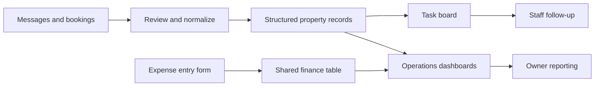

# Operations automation for short-term property management

**Portfolio case study — deliberately anonymized.** This page describes the types of workflows I designed and operated. All entity names, sample records, messages and metrics below are fictional. It does not expose a real company's customer list, source code, API keys, pricing policy or internal project links.

## Business problem

A small property-management team has to coordinate guest messages, check-ins and check-outs, cleaning, repairs, utility obligations and owner reporting. Critical information is spread across booking channels, chats, shared spreadsheets and task boards. Manual copy-paste leads to missed follow-ups, duplicate tasks and unclear responsibility.

## My role

- Collected operational needs, mapped the daily process, documented edge cases and ownership of tasks.
- Designed fields and relationships for a property/booking/task database.
- Configured Jira-based coordination and simple interfaces for entering expenses and compensations.
- Built and adjusted workflows with AI coding assistants, verified sample outputs, and reviewed user feedback.
- Set up structured interaction through LLM tools for querying operational information and preparing follow-ups.

My contribution is requirements, system design, integration, configuration, data validation and adoption. I used AI-assisted code generation rather than independently hand-writing every implementation.

## Workflow



### Example: request → action

**Fictional guest message:** “The hot water isn't working in apartment EX-102.”

1. Identify the sample apartment and booking from an authorized internal view.
2. Record an issue with a category, severity, owner and due date.
3. Send the assigned staff member the relevant non-sensitive task information.
4. Follow up on the actual repair status and record the resolution.
5. Ensure the issue is considered in operational and owner reports if appropriate.

### Example: reconciliation

A staff member records a fictional expense of **25 units** with a date, category, apartment reference and receipt. A small web form and the shared table should use the same record ID. The interface displays the entry only after reading the persisted row; duplicate submissions must be detected rather than silently creating two expenses.

## Representative data shape (fictional)

```json
{
  "property_id": "EX-102",
  "booking_id": "DEMO-004",
  "issue": {
    "category": "maintenance",
    "status": "assigned",
    "assignee": "Example Technician",
    "due_date": "2026-11-08"
  },
  "expense": {
    "amount": 25,
    "currency": "GEL",
    "category": "repair"
  }
}
```

## What this case demonstrates

A cross-system automation is not successful merely because a script runs: it needs consistent identifiers, explicit ownership, a reviewable task status, reliable write/read synchronization, and error handling. This is also why user-facing dashboards need checks against the underlying source of truth.

## Verification and limitations

This is a **workflow case description, not a public live demo**. Real booking records, owner details, guest conversations and organization code remain private. No measured improvement percentage or independently audited ROI is claimed. A standalone synthetic prototype and executable tests would be separate deliverables.
